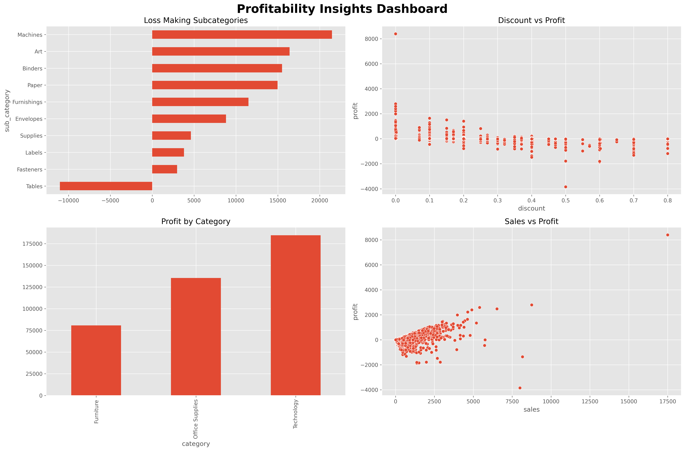

# Retail Sales & Profitability Analysis

> **Which regions, products and discount levels sell a lot but earn little?**
> SQL and Python analysis of the Superstore sales data (Jan 2011 to Dec 2014), with a 3-page dashboard drawn in Python.


| Sales | Profit | Profit margin | Orders | Customers | Avg. order value |
| :---: | :---: | :---: | :---: | :---: | :---: |
| **$3.25M** | **$0.40M** | **12.4%** | **6,717** | **795** | **$483** |

<sub>Computed from `datasets/cleaned/cleaned_sales_data.csv`: 13,297 order lines, 13 regions.</sub>

## Where the profit leaks

### 1. Deep discounts

> [!WARNING]
> Discounts above 30% turn the margin negative. 2,700 order lines (20.3% of all lines) were sold at that level and lost $197k in total.

| Discount | Order lines | Sales | Profit | Margin |
| --- | ---: | ---: | ---: | ---: |
| No discount | 7,504 | $1,816k | $472.7k | **26.0%** |
| Up to 10% | 1,180 | $496k | $87.5k | **17.6%** |
| Over 10 to 20% | 1,669 | $441k | $42.4k | **9.6%** |
| Over 20 to 30% | 244 | $90k | -$4.5k | **-5.1%** |
| Over 30 to 50% | 1,610 | $310k | -$97.4k | **-31.4%** |
| Over 50% | 1,090 | $92k | -$99.9k | **-108.8%** |

### 2. Low-margin regions

Central is the biggest region by sales, with a margin just below the 12.4% overall average. The weakest margins sit in Southeast Asia and EMEA.

| Region | Sales | Profit | Margin |
| --- | ---: | ---: | ---: |
| Central | $712k | $81.1k | **11.4%** |
| South | $418k | $39.3k | **9.4%** |
| EMEA | $217k | $13.5k | **6.2%** |
| Southeast Asia | $231k | $5.8k | **2.5%** |

**Best margins**

| Region | Sales | Profit | Margin |
| --- | ---: | ---: | ---: |
| Canada | $20k | $5.1k | **25.3%** |
| Central Asia | $181k | $36.5k | **20.1%** |
| North Asia | $238k | $45.9k | **19.3%** |

<details>
<summary>All 13 regions, best margin first</summary>

| Region | Sales | Profit | Margin |
| --- | ---: | ---: | ---: |
| Canada | $20k | $5.1k | 25.3% |
| Central Asia | $181k | $36.5k | 20.1% |
| North Asia | $238k | $45.9k | 19.3% |
| East | $177k | $31.2k | 17.7% |
| North | $301k | $46.8k | 15.6% |
| West | $174k | $26.7k | 15.3% |
| Oceania | $294k | $38.1k | 13.0% |
| Central | $712k | $81.1k | 11.4% |
| Africa | $191k | $21.4k | 11.3% |
| Caribbean | $93k | $9.4k | 10.2% |
| South | $418k | $39.3k | 9.4% |
| EMEA | $217k | $13.5k | 6.2% |
| Southeast Asia | $231k | $5.8k | 2.5% |

</details>

### 3. One loss-making sub-category

**Tables** sold $186k and lost $11.0k (a -5.9% margin). It is the only one of the 17 sub-categories with a negative total profit.

## Who earns what

| Category | Sales | Margin |
| --- | ---: | ---: |
| Technology | $1,241k | 14.9% |
| Office Supplies | $990k | 13.7% |
| Furniture | $1,014k | 8.0% |

| Segment | Share of sales | Margin |
| --- | ---: | ---: |
| Consumer | 51% | 11.9% |
| Corporate | 31% | 12.6% |
| Home Office | 18% | 13.1% |

## Recommendations

My reading of the numbers above:

- **Put a margin check on discounts above 30%.** Above that level the margin is negative, and above 50% each dollar of sales loses about $1.09.
- **Review pricing and costs in Southeast Asia, EMEA and South.** They bring $0.87M of sales at margins below 10%.
- **Check the Tables line.** It is the only sub-category that loses money.
- **Track margin next to sales** in the KPI dashboard, not sales alone.

More in [`docs/business_insights.md`](docs/business_insights.md), and a PDF summary in [`presentation/`](presentation/business_insights.pdf).

## Other dashboard pages

Drawn in Python by [`notebooks/dashboard_visuals.ipynb`](notebooks/dashboard_visuals.ipynb).

| Regional analysis | Profitability insights |
| --- | --- |
|  |  |

## How it was built

| Step | Where |
| --- | --- |
| SQL: cleaning checks, sales and profit analysis, KPIs, business questions | [`sql/`](sql/) (5 scripts, MySQL syntax, table `superstore_sales`) |
| Python: dashboard pages | [`notebooks/dashboard_visuals.ipynb`](notebooks/dashboard_visuals.ipynb) |
| Data: 51,290 raw lines, 13,297 in the cleaned file across all 7 markets, 5 columns added | [`datasets/`](datasets/), described in [`docs/data_dictionary.md`](docs/data_dictionary.md) |

<details>
<summary>Run the notebook and see the folder layout</summary>

```sh
pip install -r requirements.txt
jupyter notebook notebooks/dashboard_visuals.ipynb
```

```text
.
├── datasets/        raw and cleaned data, region and category summaries
├── sql/             5 scripts: cleaning, sales, profitability, KPIs, business questions
├── notebooks/       dashboard_visuals.ipynb
├── dashboard/       the 3 dashboard images
├── docs/            data dictionary, business insights
├── presentation/    PDF summary
└── requirements.txt
```

</details>

---
Dinesh Kumar Gudiputi, [LinkedIn](https://www.linkedin.com/in/dineshkumargudiputi/), [GitHub](https://github.com/dinesh-kumar-gudiputi)
