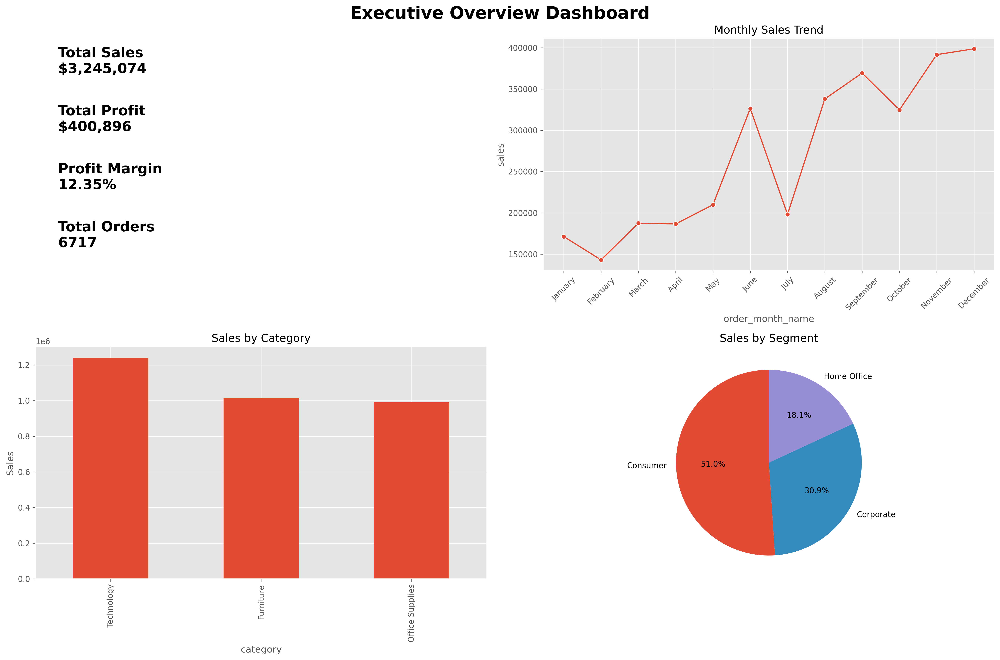
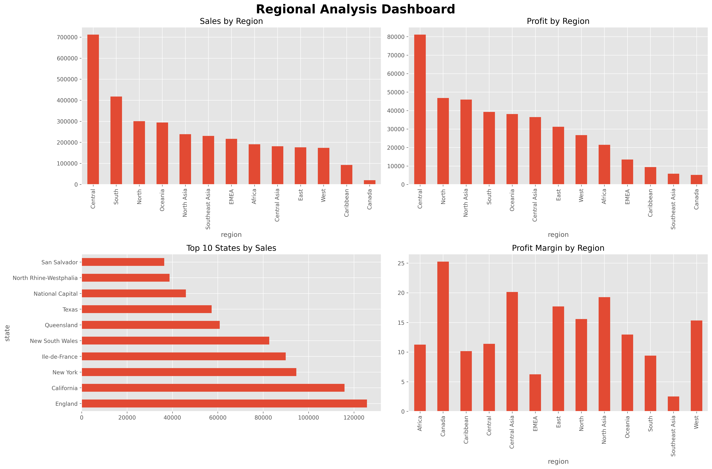

<h1 align="center">Retail Sales &amp; Profitability Analysis</h1>

<p align="center"><b>Which regions, products and discount levels sell a lot but earn little?</b></p>

<p align="center">
  
  
  
  
  
</p>

Retail sales analysis on the Superstore data (Jan 2011 to Dec 2014). SQL scripts and Python work out where sales do not turn into profit, and a 3-page dashboard drawn in Python (matplotlib and seaborn) shows the results.

## Key findings

Computed from `datasets/cleaned/cleaned_sales_data.csv`: 13,297 order lines, 6,717 orders, 795 customers, 13 regions.

| Area | Finding |
| --- | --- |
| Overall | $3.25M sales, $0.40M profit, 12.4% profit margin |
| Discounts | Lines with 0% discount earn a 26.0% margin. At 30 to 50% discount the margin is -31.4% (1,610 lines), above 50% it is -108.8% (1,090 lines) |
| Regions | Southeast Asia earns 2.5% margin on $231k sales and EMEA 6.2% on $217k. South sells $418k at 9.4%. Central is the largest region ($712k) at 11.4% |
| Categories | Technology 14.9% margin, Office Supplies 13.7%, Furniture 8.0% |
| Loss-making sub-category | Tables: $186k sales, $11.0k loss (-5.9% margin) |
| Segments | Consumer brings 51% of sales, Home Office has the best margin (13.1%) |

Recommendations that follow from this are in [`docs/business_insights.md`](docs/business_insights.md); the short version is to cap deep discounts, review pricing in the low-margin regions and watch loss-making sub-categories.

## Dashboard

Three pages, generated by [`notebooks/dashboard_visuals.ipynb`](notebooks/dashboard_visuals.ipynb). A PDF summary is in [`presentation/`](presentation/business_insights.pdf).

| Executive overview | Regional analysis | Profitability insights |
| --- | --- | --- |
|  |  |  |

KPIs shown: total sales, total profit, profit margin, total orders, total customers, average order value.

## What is in the repo

```text
.
├── datasets/
│   ├── raw/superstore_sales.csv            51,290 order lines, 21 columns
│   └── cleaned/                            13,297 order lines, 26 columns, plus category and region summaries
├── sql/                                    5 scripts, from cleaning to business questions
├── notebooks/dashboard_visuals.ipynb       builds the 3 dashboard pages
├── dashboard/                              the 3 dashboard images
├── docs/                                   data dictionary and business insights
├── presentation/business_insights.pdf
└── requirements.txt
```

## SQL scripts

| Script | Purpose |
| --- | --- |
| `01_data_cleaning.sql` | Row counts, NULL checks, duplicate order IDs, category values, date check |
| `02_sales_analysis.sql` | Total sales and orders, sales by region and category, monthly trend |
| `03_profitability_analysis.sql` | Profit by region, lowest-profit products, margin by category |
| `04_kpi_queries.sql` | Revenue, profit, margin, average order value, customer count |
| `05_advanced_business_questions.sql` | High-sales low-profit regions, categories to invest in, loss-making products, segment profit |

The scripts expect a table called `superstore_sales` loaded from the raw CSV. They use MySQL syntax (`YEAR()`, `MONTH()`, `LIMIT`).

## Data

- The cleaned file holds 13,297 of the 51,290 raw order lines, spread across all 7 markets.
- Cleaning added `profit_margin_percent`, `order_year`, `order_month`, `order_month_name` and `shipping_days`.
- Every column is described in [`docs/data_dictionary.md`](docs/data_dictionary.md).

## Run the notebook

```sh
pip install -r requirements.txt
jupyter notebook notebooks/dashboard_visuals.ipynb
```

The notebook reads the cleaned CSV and writes the three images into `dashboard/`.

## Author

Dinesh Kumar Gudiputi, [LinkedIn](https://www.linkedin.com/in/dineshkumargudiputi/), [GitHub](https://github.com/dinesh-kumar-gudiputi)
